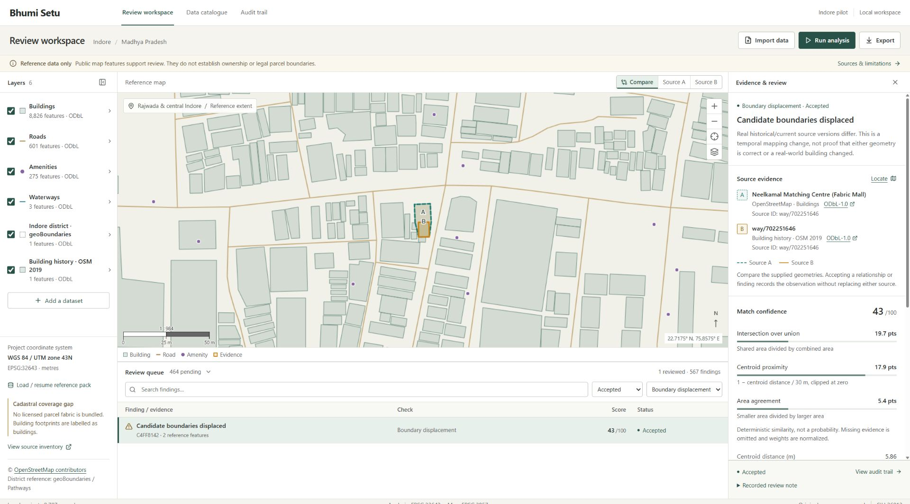
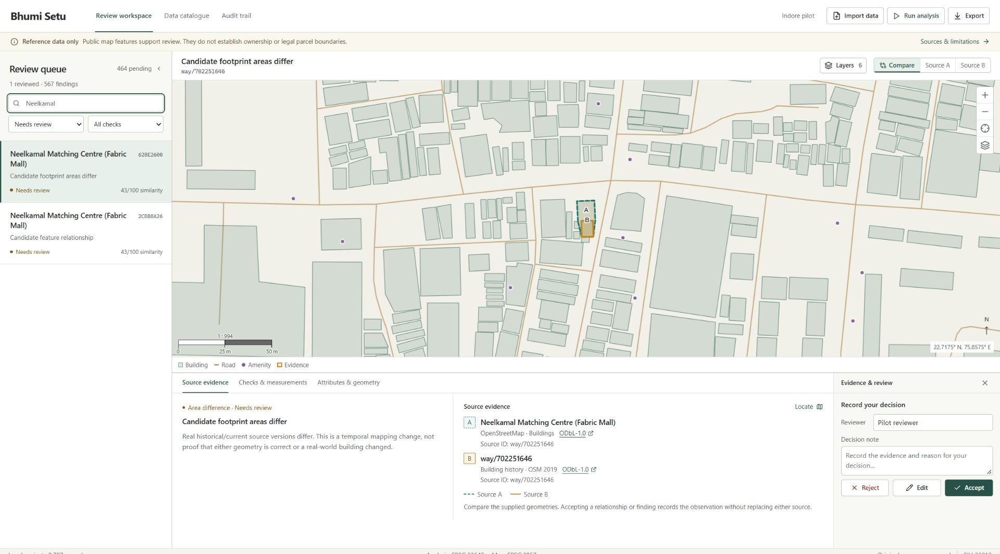

# Interface screenshots

Recorded interface captures for browsing the review workflow. They are examples from development sessions, not live application state or new verification results.

## Workspace

[Mobile workspace](reference-captures/workspace-mobile.png)

## Case review

[Mobile case review](reference-captures/case-review-mobile.png)

## Additional captures

The reference-captures folder retains the catalogue, import, audit and 1366-pixel layouts. [Earlier desktop capture](earlier-desktop.png) preserves the previous interface for comparison. Demo data, exports and their verification records remain in [artifacts/demo](../../artifacts/demo/).
